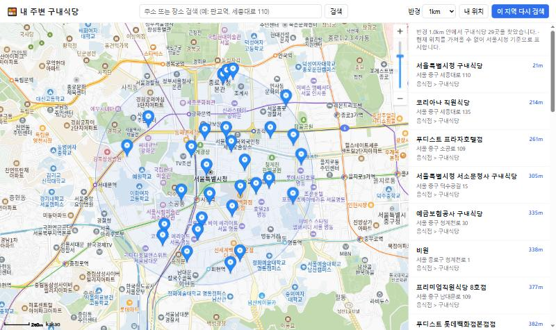
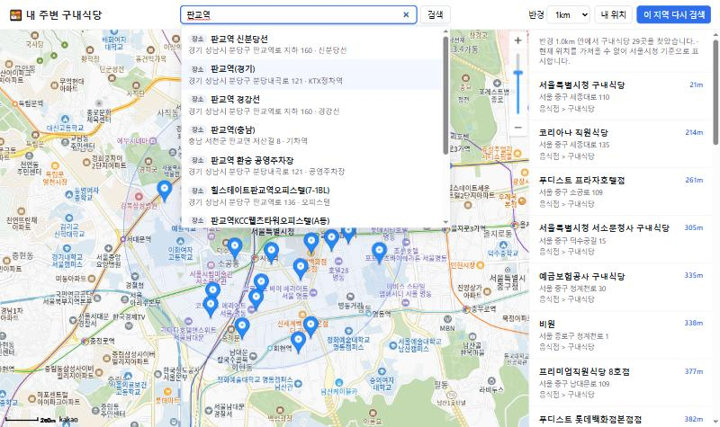
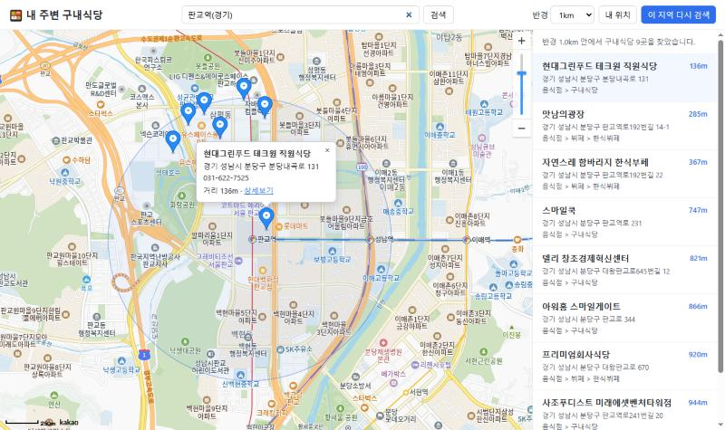
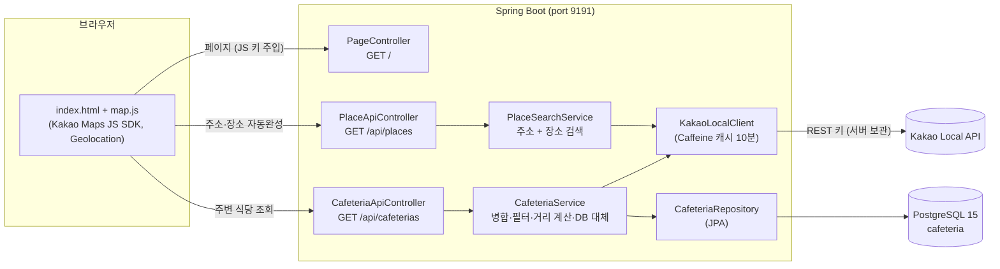

# 🍱 sicdang — 내 주변 구내식당 지도

현재 위치(또는 검색한 위치) 주변의 **구내식당**을 찾아 카카오맵 위에 표시하는 Spring Boot 웹 애플리케이션입니다.



---

## 목표

- 점심 시간에 **가까운 구내식당**을 빠르게 찾는다.
- 내 위치뿐 아니라 **주소·시설물(역, 건물 등)을 검색해 그 주변**도 찾아볼 수 있게 한다.
- 외부 API 키는 서버에만 두고, 카카오 API 장애 시에도 **저장된 데이터로 계속 서비스**한다.

## 주요 기능

| 기능 | 설명 |
|---|---|
| 내 위치 기반 검색 | 브라우저 Geolocation 으로 현재 위치를 받아 반경 내 구내식당 표시. 권한 거부 시 서울시청 기준 |
| 반경 선택 | 500m / 1km / 2km / 3km |
| 이 지역 다시 검색 | 지도를 옮긴 뒤 지도 중심 기준으로 재검색 |
| 주소·시설물 검색 | 자동완성(주소 + 장소) → 선택하면 해당 위치로 이동하고 그 주변을 재검색 |
| 마커 ↔ 목록 연동 | 거리순 목록과 지도 마커가 연동되고, 클릭 시 정보창(주소·전화·거리·카카오맵 상세보기) 표시 |
| 구내식당 필터 | 카카오 카테고리명 기준으로 `구내식당`, `한식뷔페`만 표시 (설정으로 변경 가능) |
| 장애 대비 | 검색 결과를 PostgreSQL 에 누적 저장, 카카오 호출 실패 시 DB 에서 조회 |

### 주소·시설물 검색



### 구내식당 정보창



---

## 시스템 구조



### 구내식당 검색 흐름

1. 브라우저가 `GET /api/cafeterias?lat=&lng=&radius=` 호출
2. 좌표를 소수점 셋째 자리(약 100m)로 반올림해 캐시 적중률을 높이고, 키워드(`구내식당`, `직원식당`, `한식뷔페`)별로 카카오 키워드 검색
3. 장소 ID 로 중복 제거 → 음식점(FD6) 중 카테고리명이 허용 목록에 해당하는 곳만 남김
4. 결과를 `cafeteria` 테이블에 upsert
5. 실제 요청 좌표 기준으로 거리 재계산(하버사인) → 반경 필터 → 거리순 정렬 후 응답
6. 카카오 호출 실패 시 DB 에서 위경도 범위로 조회해 `source: "DATABASE"` 로 응답

### 패키지 구조

```
src/main/java/com/sicdang
├─ SicdangApplication.java
├─ config/      KakaoProperties(설정 바인딩), KakaoClientConfig(RestClient)
├─ client/      KakaoLocalClient, dto/(카카오 응답 DTO)
├─ domain/      Cafeteria(Entity), CafeteriaRepository
├─ service/     CafeteriaService, PlaceSearchService
├─ web/         PageController, CafeteriaApiController, PlaceApiController, dto/
└─ support/     GeoUtils(거리 계산)

src/main/resources
├─ application.yml
├─ templates/index.html
└─ static/  js/map.js, css/style.css
```

### API

| Method | Path | 파라미터 | 설명 |
|---|---|---|---|
| GET | `/api/cafeterias` | `lat`, `lng`, `radius`(100~5000, 기본 1000) | 주변 구내식당 목록 (거리순) |
| GET | `/api/places` | `query`(1~100자) | 주소 검색 결과 + 장소 검색 결과 |

<details>
<summary>응답 예시</summary>

```json
// GET /api/cafeterias?lat=37.5665&lng=126.978&radius=1000
{
  "source": "KAKAO",
  "lat": 37.5665, "lng": 126.978, "radius": 1000,
  "items": [
    {
      "id": "12345678", "name": "서울특별시청 구내식당", "category": "음식점 > 구내식당",
      "phone": null, "address": "서울 중구 태평로1가 31", "roadAddress": "서울 중구 세종대로 110",
      "lat": 37.5664, "lng": 126.9779, "distance": 21,
      "placeUrl": "http://place.map.kakao.com/12345678"
    }
  ]
}

// GET /api/places?query=세종대로 110
[
  { "type": "ADDRESS", "name": "서울특별시청", "address": "서울 중구 세종대로 110", "category": null, "lat": 37.5663, "lng": 126.9779 },
  { "type": "PLACE",   "name": "서울특별시청", "address": "서울 중구 세종대로 110", "category": "사회,공공기관 > ...", "lat": 37.5668, "lng": 126.9786 }
]
```
</details>

---

## 개발 환경

| 항목 | 버전 |
|---|---|
| OS | Windows 10 |
| JDK | 17 |
| Build | Gradle 9.7.1 (wrapper 포함) |
| DB | PostgreSQL 15 (extension 불필요) |
| IDE | IntelliJ IDEA |

## 사용 기술

- **Backend**: Spring Boot 4.1.1 (Web MVC, Data JPA, Validation, Cache, Thymeleaf), Hibernate, Lombok
- **HTTP Client**: Spring `RestClient`
- **Cache**: Caffeine (카카오 검색 결과 10분, 최대 2,000건)
- **DB**: PostgreSQL 15
- **Frontend**: Vanilla JavaScript, Kakao Maps JavaScript SDK (빌드 도구 없음)
- **External API**: Kakao Local API (키워드 검색, 주소 검색)

---

## 실행 방법

### 1. DB 생성

```sql
CREATE DATABASE sicdang;
```

테이블(`cafeteria`)은 첫 실행 시 자동 생성됩니다 (`ddl-auto: update`).

### 2. 카카오 키 발급

[Kakao Developers](https://developers.kakao.com) 에서 앱을 만들고:

- **REST API 키** — 서버에서 장소·주소 검색에 사용
- **JavaScript 키** — 브라우저 지도에 사용
- **플랫폼 > Web** 에 `http://localhost:9191` 등록
- **카카오맵(지도/로컬) 사용 설정 ON** — 꺼져 있으면 `403 disabled OPEN_MAP_AND_LOCAL service` 오류

### 3. 로컬 설정 파일

`config/application.yml.example` 을 `config/application.yml` 로 복사한 뒤 값을 채웁니다.
프로젝트 루트에서 실행하면 Spring Boot 가 자동으로 읽으며, 이 파일은 `.gitignore` 처리되어 있습니다.

```yaml
spring:
  datasource:
    url: jdbc:postgresql://localhost:5432/sicdang
    username: postgres
    password: CHANGE_ME
kakao:
  rest-key: CHANGE_ME
  js-key: CHANGE_ME
```

환경변수(`DB_URL`, `DB_USERNAME`, `DB_PASSWORD`, `KAKAO_REST_KEY`, `KAKAO_JS_KEY`)로 지정해도 됩니다.

### 4. 실행

```bash
./gradlew bootRun
```

브라우저에서 http://localhost:9191 접속

## 설정 항목

`src/main/resources/application.yml`

| 키 | 기본값 | 설명 |
|---|---|---|
| `server.port` | `9191` | 서버 포트 |
| `kakao.keywords` | `구내식당`, `직원식당`, `한식뷔페` | 구내식당 후보를 찾기 위한 검색 키워드 |
| `kakao.category-includes` | `구내식당`, `한식뷔페` | 카테고리명에 이 문자열이 포함된 곳만 표시 |
| `spring.cache.caffeine.spec` | `maximumSize=2000,expireAfterWrite=10m` | 카카오 검색 캐시 정책 |

---

## 참고 사항

- 위치 권한은 `localhost` 또는 HTTPS 에서만 동작합니다. 외부 배포 시 HTTPS 가 필요합니다.
- 카카오 키워드 검색은 키워드당 최대 45건까지만 조회됩니다. 밀집 지역에서 반경을 크게 잡으면 일부가 누락될 수 있습니다.
